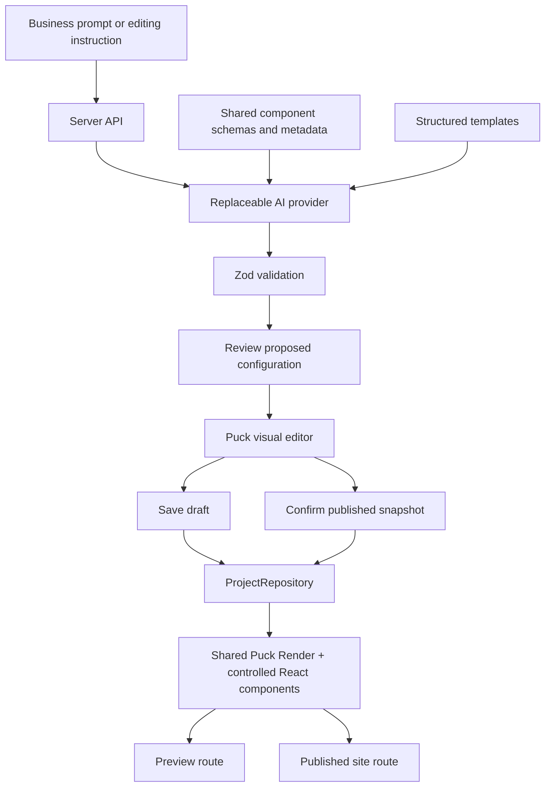

# Nexus website builder implementation

## Architecture audit

The original repository is a buildless application in `dist/`, with static HTML, plain JavaScript, two global stylesheets, hash navigation, and module-level UI state. It has no Next.js, React, TypeScript, Tailwind, authentication, API routes, database or existing component framework. `app.js` provides the dashboard; `experience.js` and `workspace.js` add the commercial homepage and project screens. The earlier `composer.js` was a visual sketch with temporary state.

The existing homepage, workspace, and hash routes are retained. A bounded React/TypeScript application in `builder/` adds Puck. Vite builds only to `dist/builder/` and never clears the existing `dist/` application. Express serves both applications and the builder API. The legacy builder buttons redirect through `builder-bridge.js`. The earlier composer files remain available in Git but are no longer loaded.



## Running locally

Requires Node 22.12+ (tested on Node 24.16) and npm.

```sh
npm ci
npm run dev
```

Open `http://localhost:4173/` for Nexus and `http://localhost:4173/builder` for the builder. The original static Python server still serves the original screens, but it cannot serve the new API or Puck routes. Use the npm server for this feature.

```sh
npm test
npm run build
npm start
```

`npm start` serves the built application with the same server/API. Build artifacts are ignored; source and the lockfile are tracked. `PORT` defaults to 4173. The prototype binds to loopback and has no authentication.

## Routes and workflow

- `/builder`: business prompt, SaaS/Fintech/Agency templates, blank projects, saved project list.
- `/builder/:projectId`: Puck canvas, registered blocks, outline, properties, global theme fields, desktop/tablet/mobile controls, undo/redo, project naming, save, preview, and publish.
- `/preview/:projectId`: the saved draft, with no editor chrome. Preview saves the current draft first.
- `/site/:slug`: the last published snapshot, rendered with the same component config as preview. Draft edits do not change it. This is a route on the running local server, not an external hosted domain.

Use the Assistant button for a collapsible panel. Edits produce a change summary and proposed JSON. Apply is explicit and adds a Puck history entry. If the document changed while a proposal was being prepared, applying it is rejected. Invalid responses and save failures preserve existing saved data.

## Components and registration

Thirty-three registered components are grouped in the Puck drawer by purpose and industry: site structure, hero and calls to action, story and trust, media and editorial, forms and signups, restaurant and cafe, beauty and wellness, retail and hospitality, education and community, and business and SaaS. The catalog includes visual, text, commerce, hospitality, editorial, team, careers, metrics, and resource blocks, plus inquiry, newsletter, appointment, and table-reservation forms. Restaurant & Cafe and Beauty & Wellness starter templates show these blocks in complete page flows.

Typed renderers live in `builder/src/components/website/Sections.tsx` and `builder/src/components/website/blocks/`. The component drawer uses Puck's `drawerItem` override to display small local CSS previews and a short description beside each draggable block. Forms are visual previews only; they do not send or store submissions. Theme controls include solid, gradient, and soft Gaussian glow backgrounds, with editable gradient and glow colors.

`builder/shared/schema.ts` defines each component's allowed props, variants, defaults, bounded lists, URL restrictions and theme. `builder/src/puck/config.tsx` maps those definitions to known React renderers. The field adapter generates text, multiline text, select, radio, object and list controls from the same schemas. Plain string lists use a small reusable multiline field. Image URL and alt text fields are provider-independent; empty images render a built-in product illustration. Uploads/media libraries can later replace the image field without changing the document contract.

To add a controlled section: add its schema, default props, metadata description and renderer, then put its name in a Puck category. No arbitrary JSX, HTML, dynamic scripts or `eval` are supported.

## Themes and templates

The theme is stored once in `data.root.props.theme`. The root Theme wrapper exposes validated CSS variables for colors, heading/body fonts, radius, buttons, container width and spacing. All sections consume them. Section-specific tone is a controlled token choice (base/muted/dark/accent), not arbitrary CSS.

`builder/shared/templates.ts` defines three structured templates: Modern SaaS, Premium Fintech and Independent Agency. Each is composed of registered blocks, a root title, and a global theme, with new unique component IDs per project. Templates contain editable placeholder proof and contact-based illustrative pricing, not fabricated customer claims. Restaurant and Portfolio are extension categories, not implemented templates in this MVP.

## Document and project data

```json
{
  "template": "saas-modern",
  "data": {
    "root": {
      "props": {
        "title": "ResolveAI",
        "theme": {
          "primaryColor": "#3156d3",
          "backgroundColor": "#ffffff",
          "textColor": "#172554"
        }
      }
    },
    "content": [
      {
        "type": "Hero",
        "props": {
          "id": "unique-id",
          "headline": "Resolve support with clarity.",
          "variant": "split-image"
        }
      }
    ]
  }
}
```

This abbreviated input is normalized by defaults for omitted optional theme/component values. The persisted document contains the complete validated configuration. The supported Puck subset is root props and flat content; empty Puck zones are discarded at the editor boundary. Nested zones/dynamic configuration are deliberately unsupported. Duplicate component IDs and unknown props are rejected.

Projects include `id`, `name`, optional `ownerId`, `slug`, `document`, `status`, `createdAt`, `updatedAt`, `publishedAt`, and `publishedDocument`. The document contains its template, theme and Puck data, avoiding duplicated theme fields. No authenticated owner is assigned because the original app has no auth.

`ProjectRepository` is the server persistence interface. `JsonProjectRepository` writes validated projects to ignored `.nexus-data/projects.json` using a temporary file and rename. Single-process writes are serialized; slugs are unique. Optimistic `expectedUpdatedAt` checks prevent stale editors from overwriting newer saves. Replace this adapter with database transactions when deploying across instances. Do not commit local project records.

## AI generation and editing

`WebsiteAIProvider` exposes `generateWebsite(prompt)` and `editWebsite(current, instruction)`. The browser only talks to Nexus API routes; it never imports provider implementations or receives credentials.

`POST /api/website-builder/ai/generate` validates the prompt, invokes the configured server provider, validates and normalizes its response, and returns a document. The browser validates again before creating a saved draft and loading Puck.

`POST /api/website-builder/ai/edit` validates the prompt/current document and provider output. The provider receives compact component metadata, theme rules, template summaries, the current document and the instruction. React source is never sent. Responses are full validated configurations; the review UI highlights changed props, added/removed blocks, theme changes, and reordered sections. They do not replace project source files.

`prompts.ts` builds context from the shared schemas. Default lists and repeated schema headers are omitted from component metadata to reduce tokens. The system prompt requires concise professional copy and forbids invented claims or unsupported components. Actual factual accuracy of model-generated copy still requires user review; schema validation cannot verify business facts.

### Providers and environment

Default: `WEBSITE_AI_PROVIDER=demo`. This deterministic rules composer is explicitly labeled in the UI and requires no key or model. It supports template selection by business keywords, business names after “called/named”, dark/light themes, premium spacing, hero CTA edits, named-section insertion, swapping sections, and enterprise pricing. Unsupported open-ended instructions return a helpful error rather than pretending to understand them.

For real model assistance, copy `.env.example` to `.env` and set:

```dotenv
WEBSITE_AI_PROVIDER=compatible
WEBSITE_AI_BASE_URL=https://your-provider.example/v1
WEBSITE_AI_MODEL=your-model
WEBSITE_AI_API_KEY=server-only-secret
PORT=4173
```

The implemented provider uses the OpenAI-compatible `/chat/completions` protocol and JSON response mode, with server-side timeout, body-size limits, and response validation. The key may be omitted for a trusted local endpoint that requires no authentication. Providers must support that protocol and JSON mode; native Anthropic or other incompatible endpoints need another provider class. Do not put secrets in client-prefixed environment variables. Live model output has not been tested without provider credentials.

### Optional Puck AI investigation

Official Puck AI uses `@puckeditor/plugin-ai` plus a server-side `@puckeditor/cloud-client`, a Puck Cloud account and `PUCK_API_KEY`. Its headless `generate()` API accepts a Puck config, prompt and optional `pageData` for edits. Sources: [official setup](https://puckeditor.com/docs/ai/getting-started), [headless generation](https://puckeditor.com/docs/ai/headless-generation).

This is an optional future `WebsiteAIProvider` adapter. These Cloud packages are not installed or required here. Assembly mode would be appropriate; design mode and dynamic generated components conflict with this MVP's controlled registry. Any future Cloud response must pass the same schemas before it reaches the editor.

## Files and dependencies

Created: root `package.json`, `package-lock.json`, `tsconfig.json`, `vite.config.ts`, `.env.example`; `builder/index.html`; shared `schema.ts`, `catalog.ts`, `templates.ts`, `project.ts`; React entry/router, route modules, UI components, Theme/Sections/styles, Puck config/field adapter, API/diff modules; server entry/API/storage and `server/ai/*`; `tests/builder.test.ts`; `dist/builder-bridge.js`; these notes.

Modified: `dist/index.html` (loads the real builder bridge), `.gitignore`, `README.md`, `DESIGN.md`. Existing dashboard/hompage source remains in place.

Runtime dependencies: Puck core **0.23.0**, React, React DOM, Express, Zod. Development: TypeScript, Vite and its React plugin, tsx, type definitions and Prettier. Exact resolved versions are in `package-lock.json`.

## Verification and practical limits

Automated tests cover all templates/defaults, URL and component validation, duplicate IDs, demo edits preserving unrelated sections, failed-provider state preservation, durable storage, unique slugs, published snapshot isolation, stale save rejection, and cross-origin write rejection. Type checking and production build are required checks. Browser checks cover generation, manual hero editing, reviewed changes, undo/redo, save, clean preview and publication.

The implementation is a local single-instance MVP. It has no account authentication, tenant permission enforcement, custom domains, hosted deployment, media uploads, real form capture, payments, analytics or CRM writes. Preview/sites use client-side rendering; SSR/SEO metadata and external hosting need follow-up work. The product generator creates one page per website project; full multipage navigation is a future extension. The built-in SVG-like product illustration and text placeholders do not imply integrations or verified customers.

Recommended next steps: configure and evaluate a real provider; add authenticated ownership and tenant access checks; migrate storage to the platform database; add multi-page project structure and version history; connect approved CRM/billing data; add media uploads and deployment. Future generated components belong in an isolated review/sandbox pipeline before registration, never in the normal page renderer.
